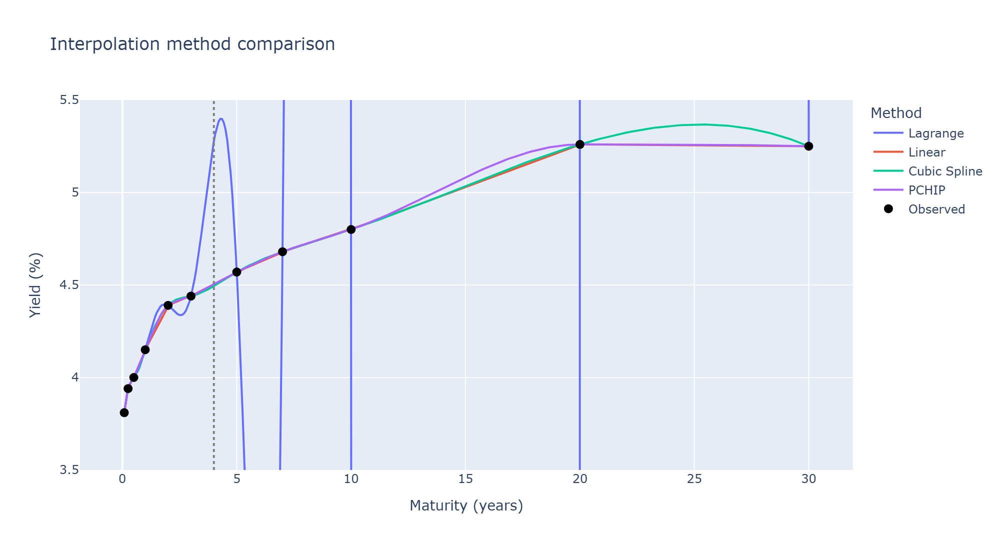
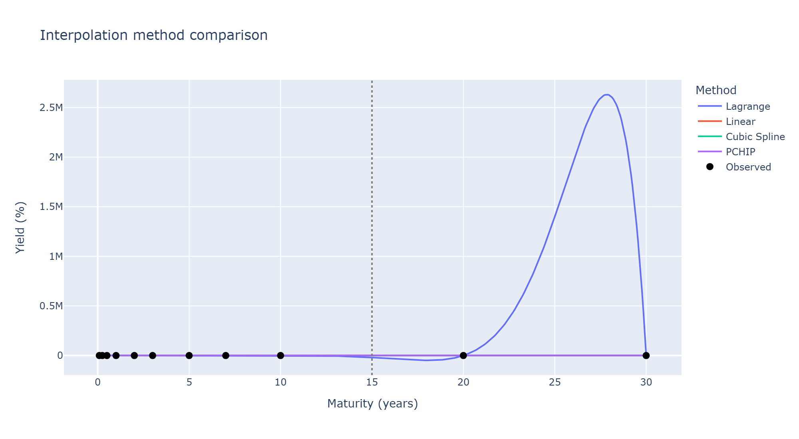
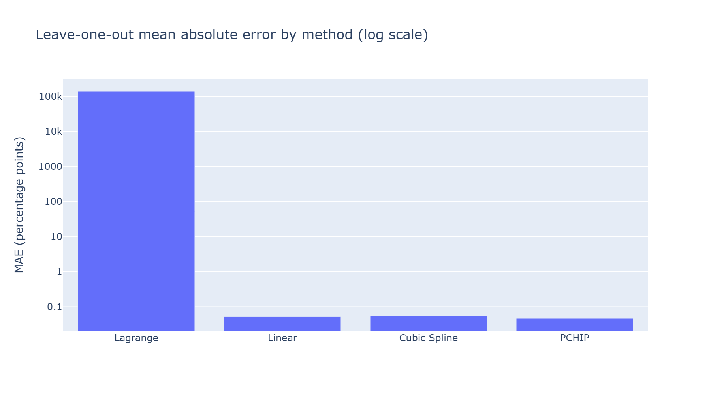
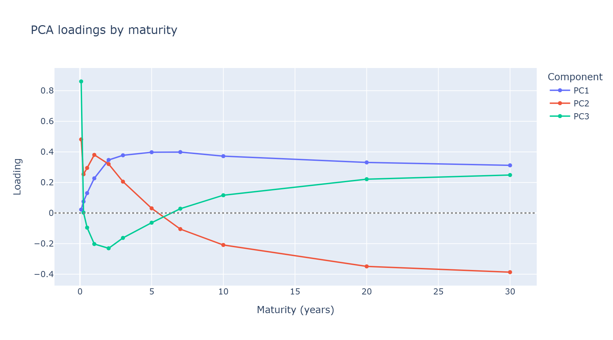
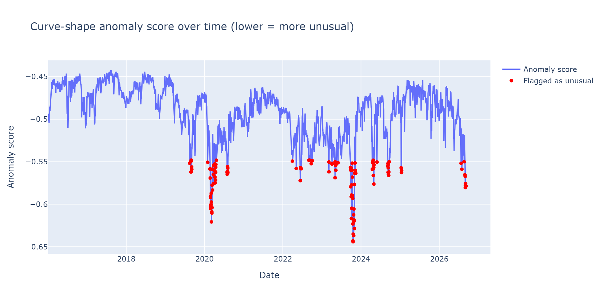

# Yield Curve Intelligence Platform

**Live demo:** https://huggingface.co/spaces/nyakslamo/yield-curve-intelligence
**Source:** this repository | **License:** MIT

An interactive tool for analyzing the U.S. Treasury yield curve: multi-method interpolation
(Lagrange, linear, cubic spline, PCHIP) compared honestly — including where Lagrange
catastrophically diverges on the real grid — leave-one-maturity-out validation, PCA factor
analysis (level/slope/curvature, verified against real data), and anomaly detection against
~10 years of history.

## Business problem

Treasury publishes yields only at specific maturities (1 month, 3 months, ..., 30 years). Anyone
needing a yield at an unreported maturity — a risk analyst, a student, a researcher — has to
*estimate* it. Different estimation methods can disagree, sometimes by an enormous amount, in the
wide gaps between Treasury's published tenors (there's a 10-year gap between the 10Y and 20Y
points). This project makes that disagreement visible and *measured*, rather than hidden behind a
single black-box number — and demonstrates the same math (PCA, anomaly detection) that real
fixed-income risk systems use to describe how the curve moves.

**What this is explicitly not:**
- Not a forecast — interpolation estimates yields *between* observed maturities on a date that
  already happened, never in the future.
- Not investment advice or a trading signal generator.
- Not a full term-structure model — v1 works with observed par yields only; zero-coupon
  bootstrapping, discount factors, and forward rates are distinct, more advanced concepts this
  version does not implement (and says so in the app).

## Screenshots

**Where methods agree (dense region, 4Y target):** local methods track the observed curve
closely; Lagrange already wobbles and goes off-scale beyond the visible node cluster.



**Where methods catastrophically disagree (sparse 10Y-20Y gap, 15Y target):** Lagrange peaks
above 2.5 **million** percent; the three local methods stay flat near zero on this scale.



**Leave-one-out validation** — Lagrange's error is ~6 orders of magnitude larger than the other
three methods (log scale; PCHIP wins on this date):



**PCA loadings**, reproducing the classic Litterman-Scheinkman level/slope/curvature shapes from
real data — not assumed, verified by inspecting these exact curves:



**Anomaly score over ~10 years of history** — visible troughs at the 2020 COVID onset and the
2023 yield-spike episode, both independently flagged by the model, not hand-picked:



## Architecture

```text
app.py                        Gradio UI wiring only -- no business logic
src/
  data/                       Treasury.gov client, graceful-fallback loader, validation
  interpolation/               Lagrange (hand-derived), linear, cubic spline, PCHIP
  features/                   Daily yield-change feature engineering
  models/                     PCA, anomaly detection, leave-one-out validation,
                               GPU-batched historical stress test
  visualization/               Plotly figure builders (UI-agnostic, independently tested)
  utils/                      Maturity parsing, curve classification, logging
tests/                        Mirrors src/, 119+ tests including real-data regression tests
data/sample/                  Small bundled offline fallback (2025-2026)
data/historical/               Real bundled 2016-2026 daily data (~920KB) for PCA/anomaly
deploy/                       HF Space-specific requirements.txt (+torch/spaces) and README
docs/lagrange_derivation.md   Full worked derivation
DECISIONS.md                  Every architectural/modeling decision, with reasoning
LEARNING_LOG.md               Concepts, problems encountered, and how they were diagnosed
```

Every quantitative computation lives in `src/` and is independently testable without Gradio
running; `app.py` only wires those results into UI components.

## Data source

[U.S. Department of the Treasury — Daily Treasury Par Yield Curve Rates](https://home.treasury.gov/resource-center/data-chart-center/interest-rates/daily-treasury-rates.csv/2026/all?type=daily_treasury_yield_curve),
nominal par yields. Verified live against the actual endpoint, not assumed. The maturity grid
itself is not fixed — it has grown from 11 published tenors in 2016 to 14 by 2026 as Treasury
added shorter bills — handled by parsing labels generically rather than a hard-coded lookup table
(see `DECISIONS.md`). Live fetches fall back gracefully to bundled sample data if Treasury.gov is
unreachable, with the UI always disclosing which source is showing and as of when.

## Mathematical methods

**Lagrange interpolation** is implemented from the defining formula (not called from a library):
$P(x) = \sum_j y_j L_j(x)$, where each basis polynomial $L_j$ acts as a "switch" — 1 at its own
node, 0 at every other. Cross-checked against `scipy.interpolate.BarycentricInterpolator` and the
(now scipy-deprecated) `scipy.interpolate.lagrange`, agreeing to `1e-8`. Full derivation and a
hand-worked real example: `docs/lagrange_derivation.md`.

**Linear, cubic spline, and PCHIP** wrap trusted `numpy`/`scipy` implementations, behind a shared
interface and shared extrapolation-warning logic, so the app can compare all four identically.

**The core empirical result:** on the real, full 11-node Treasury grid, Lagrange diverges to
approximately **−19,627%** at 15Y, and its leave-one-out error after removing the 20Y node reaches
approximately **−1,228,749 percentage points**. This is not a bug in the implementation (verified
against a trusted library) — it is what a single degree-10 global polynomial genuinely does with
unevenly spaced real nodes (Runge's phenomenon). Linear, cubic spline, and PCHIP all stay within a
fraction of a percentage point in the same region.

## Machine-learning methods

**PCA** runs on *raw, unscaled* daily yield changes — a deliberate choice matching standard
fixed-income practice (Litterman & Scheinkman, 1991), not a default. Verified on real 2016-2026
history: PC1 explains 72.6% of variance (same sign across every maturity → **Level**), PC2 10.6%
(one sign change, short vs. long → **Slope**), PC3 9.1% (two sign changes, a hump shape →
**Curvature**) — reproducing the classic finding from real data, with labels assigned from the
*observed loading shape*, never assumed from component order.

**Anomaly detection** (Isolation Forest, standardized daily yield levels) independently flags
October 2023 (the real 10Y Treasury yield spike to ~5%, highest since 2007) and early March 2020
(COVID market panic onset) among the most unusual dates in the whole window — both genuine,
verifiable market events, not cherry-picked. The current date ranks in the 1.3rd percentile of
historical unusualness.

## Validation results

Leave-one-maturity-out validation (only *interior* maturities are evaluated — removing an
endpoint would make the held-out estimate an extrapolation, contaminating the measurement):

| Method | MAE | RMSE | Max abs error |
|---|---|---|---|
| PCHIP | 0.047 | 0.068 | 0.176 |
| Cubic Spline | 0.055 | 0.079 | 0.209 |
| Linear | 0.052 | 0.087 | 0.235 |
| Lagrange | 136,758 | 409,584 | 1,228,750 |

(2026-09-08; all values in percentage points. PCHIP wins on this date — based on 9 interior
points from a single day's curve, not a general claim that holds on every date.)

## Limitations

- **Par yields only** — not zero-coupon/spot yields, discount factors, or forward rates.
- **Small-sample validation** — leave-one-out uses ~9 interior points per curve; method rankings
  describe *this date*, not a universal guarantee.
- **Model risk** — every method embeds assumptions (smoothness, shape-preservation) that may not
  hold on any given date; anomaly scores are statistical rarity, not a crisis or trading signal.
- **GPU stress-test honesty** — the real speedup in that feature comes from *vectorization*
  (~23 minutes naive vs. ~0.24s batched, measured), not GPU hardware specifically; GPU is used
  because this account's free Space tier requires a genuine `@spaces.GPU` function, not because
  this problem size needs GPU to be fast.
- **Known dependency findings** — `pip-audit` flags CVEs in `pillow`/`starlette` (transitive via
  `gradio`); deferred to Dependabot rather than a risky major-version bump under time pressure
  (see `DECISIONS.md`).

## Local setup

```bash
python -m venv .venv
.venv\Scripts\Activate.ps1   # Windows PowerShell
python -m pip install -r requirements-dev.txt
pytest
python app.py
```

## Testing and deployment

- **119 tests**, `ruff` clean, including real-data regression tests (not just synthetic) for PCA,
  anomaly detection, and the bulk GPU stress test — each cross-checked against a trusted
  independent calculation before being trusted.
- **Docker**: `Dockerfile` verified by staging its exact `COPY` file set in an isolated directory
  and running the app from there (no Docker available in this dev environment) — caught a real
  missing-file bug (`data/historical/`) this way before it could reach a real container.
- **CI** (`.github/workflows/ci.yml`): lint, test (Python 3.11-3.13), Docker build check,
  `pip-audit` (informational). Currently blocked from actually running by a GitHub account billing
  lock unrelated to this repo's code (see `DECISIONS.md`).
- **Deployment**: verified end-to-end, not assumed — public URL confirmed responding, all three
  interactive API endpoints called live via `gradio_client` with results matching local
  verification exactly, and the GPU stress-test endpoint confirmed actually running on a real GPU
  (`Computed on device: cuda`).

## Repository map

See `DECISIONS.md` for every architectural and modeling decision made (with reasoning) and
`LEARNING_LOG.md` for concepts covered, problems encountered, and how each was diagnosed rather
than guessed at.

## Responsible use

This application is for education and research. It is not investment advice. Estimates have model
risk; market data may be delayed or revised; anomaly scores are not trading signals. See the
in-app Responsible Use tab for the full statement.

## License

MIT — see `LICENSE`.

## Author

Lameck Nyakweba — M.S. Quantitative Methods, Mathematical Finance concentration; aspiring AI
Engineer in Quantitative Research.
